<picture>
  <source media="(prefers-color-scheme: dark)" srcset="docs/img/readme-header-dark.png">
  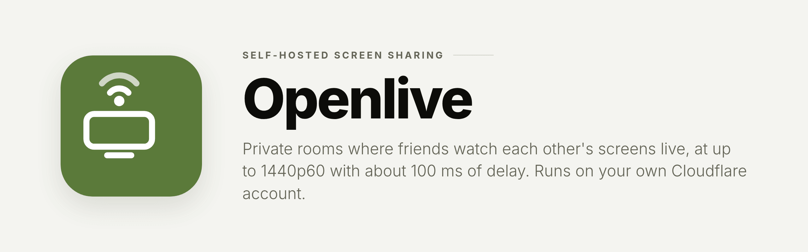
</picture>

# Openlive

Openlive is a private alternative to Discord for groups of friends: rooms with screen streams,
voice, text and cameras, on a server you own. Each group runs its own instance on its own
Cloudflare account, so the rooms, the members, the messages and the bandwidth bill are theirs.

Someone in a room clicks **Go live**, a small helper on their computer captures and encodes the
screen with the app's sound, Cloudflare Realtime carries it, and everyone else in the room watches
in the browser about a tenth of a second behind, with nothing to install. The same room can have a
voice channel with cameras and a text chat.

## Why Openlive

- **Privacy.** Accounts, rooms, chat and usage live in your group's own Cloudflare account.
  Nothing is recorded, there are no ads and nothing scans your content.
- **Ownership and control.** Sign-up is by invite, and the group sets its own roles, room rules
  and bans. No platform decides what your group can do or whether it exists. The code is
  AGPL-3.0 and you host it yourself.
- **Quality without a subscription.** Streams up to 4K60 (1080p120 and 1440p120 if the admin
  allows), about 100 ms behind the streamer's screen, for everyone in the group. Discord's
  public Go Live tiers list HD streaming as a [Nitro](https://discord.com/nitro) perk.

|                               | Openlive                                                           | Discord                                   |
| ----------------------------- | ------------------------------------------------------------------ | ----------------------------------------- |
| Screen streams                | Up to 4K60, 120 fps up to 1440p (opt-in), ~100 ms, no subscription | HD streaming is a Nitro perk              |
| Voice                         | Per room: mute, deafen, push-to-talk, per-person volume            | Yes                                       |
| Text                          | Per room: mentions, unread, retention you choose (none to 90 d)    | Yes                                       |
| Cameras                       | In voice, 360p and 180p layers, 6 per room by default              | Yes                                       |
| Who holds the data            | Your group, in your Cloudflare account                             | Discord                                   |
| Who sets the rules            | Your group's admins                                                | Discord's terms, then the server's admins |
| Cost                          | Free within Cloudflare's 1,000 GB a month; brakes at your limit    | Free, with paid Nitro tiers               |
| DMs, bots, push notifications | Not yet                                                            | Yes                                       |

Openlive's numbers are measured on one machine (see [Numbers](#numbers)); there is no measured
side-by-side test against Discord.

**Honest limits.**

- "Free" means within Cloudflare's free tier, 1,000 GB of egress a month. Above it Cloudflare
  bills US$ 0.05 per GB, and the app warns and brakes at the monthly limit the admin picks.
- It depends on Cloudflare as infrastructure. That is a much smaller dependency than a social
  network: the account, the code and the data are yours, and the code is portable.
- Not there yet: direct messages, bots and integrations, push notifications, a native mobile app
  (the installable web app covers phones). Openlive is for private groups, not large public
  communities.

## Screenshots

All taken from the real app on a local instance with made-up people (`pnpm screenshots`, see
[scripts/screenshots](scripts/screenshots/README.md)). They follow your GitHub theme; voice and
cameras use Chrome's fake microphone and camera.

<picture>
  <source media="(prefers-color-scheme: dark)" srcset="docs/img/screens/player-dark.png">
  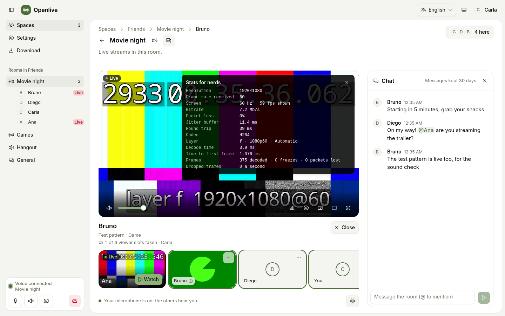
</picture>

<table>
  <tr>
    <td width="50%">
      <picture>
        <source media="(prefers-color-scheme: dark)" srcset="docs/img/screens/room-dark.png">
        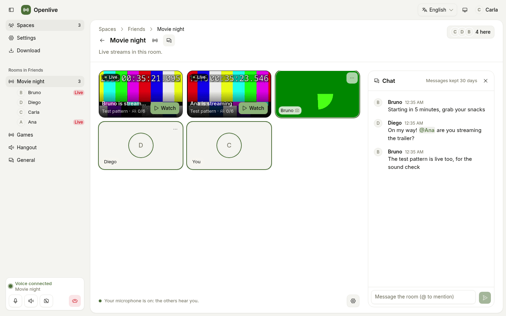
      </picture>
      <p align="center">Watch together: live streams and people in voice as tiles, the chat beside</p>
    </td>
    <td width="50%">
      <picture>
        <source media="(prefers-color-scheme: dark)" srcset="docs/img/screens/go-live-dark.png">
        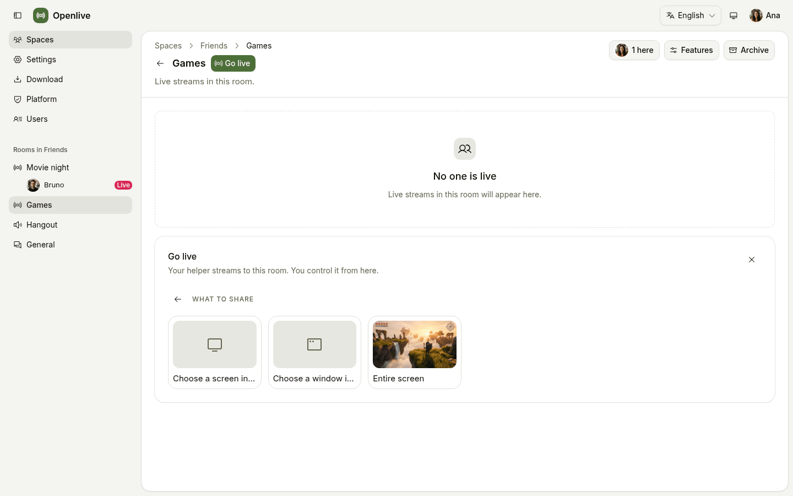
      </picture>
      <p align="center">Go live from the web: source, quality and sound</p>
    </td>
  </tr>
  <tr>
    <td>
      <picture>
        <source media="(prefers-color-scheme: dark)" srcset="docs/img/screens/room-voice-dark.png">
        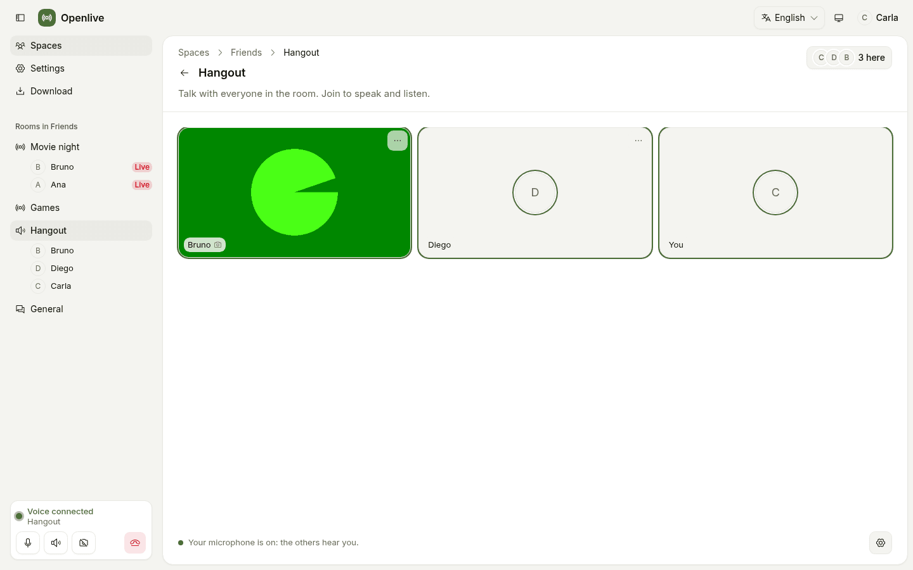
      </picture>
      <p align="center">A voice channel, with cameras</p>
    </td>
    <td>
      <picture>
        <source media="(prefers-color-scheme: dark)" srcset="docs/img/screens/room-chat-dark.png">
        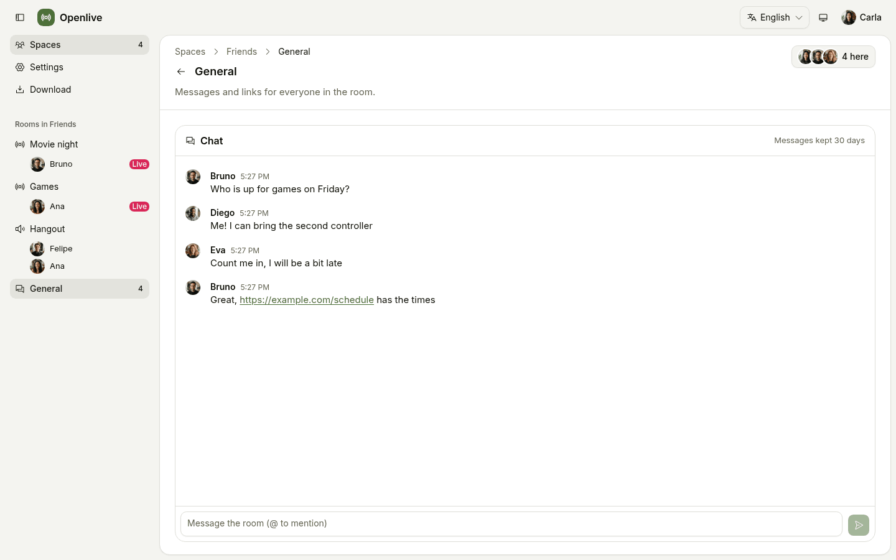
      </picture>
      <p align="center">A text channel</p>
    </td>
  </tr>
  <tr>
    <td>
      <picture>
        <source media="(prefers-color-scheme: dark)" srcset="docs/img/screens/space-rooms-dark.png">
        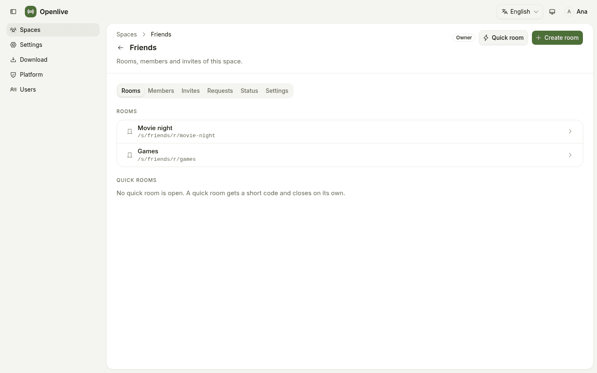
      </picture>
      <p align="center">A space and its rooms</p>
    </td>
    <td>
      <picture>
        <source media="(prefers-color-scheme: dark)" srcset="docs/img/screens/space-members-dark.png">
        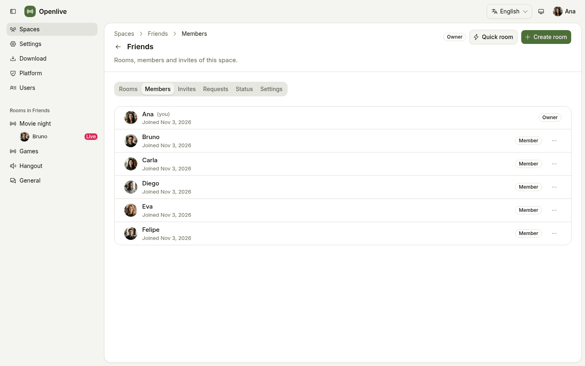
      </picture>
      <p align="center">Members and roles</p>
    </td>
  </tr>
  <tr>
    <td>
      <picture>
        <source media="(prefers-color-scheme: dark)" srcset="docs/img/screens/admin-overview-dark.png">
        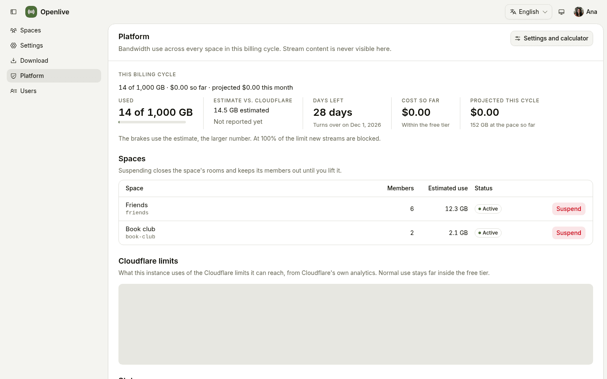
      </picture>
      <p align="center">Platform overview: the month's bandwidth and cost</p>
    </td>
    <td>
      <picture>
        <source media="(prefers-color-scheme: dark)" srcset="docs/img/screens/admin-settings-dark.png">
        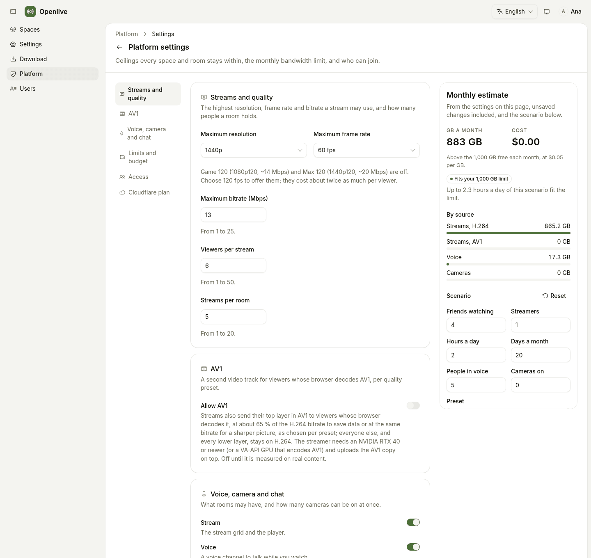
      </picture>
      <p align="center">Ceilings, cost calculator and monthly limit</p>
    </td>
  </tr>
  <tr>
    <td>
      <picture>
        <source media="(prefers-color-scheme: dark)" srcset="docs/img/screens/admin-users-dark.png">
        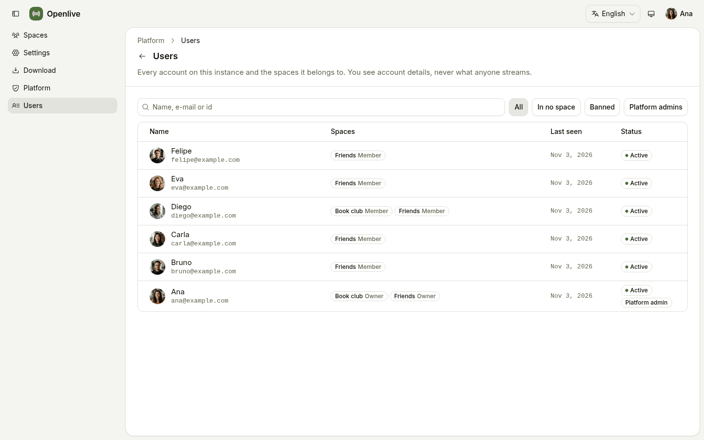
      </picture>
      <p align="center">Every account on the instance</p>
    </td>
    <td>
      <picture>
        <source media="(prefers-color-scheme: dark)" srcset="docs/img/screens/admin-setup-dark.png">
        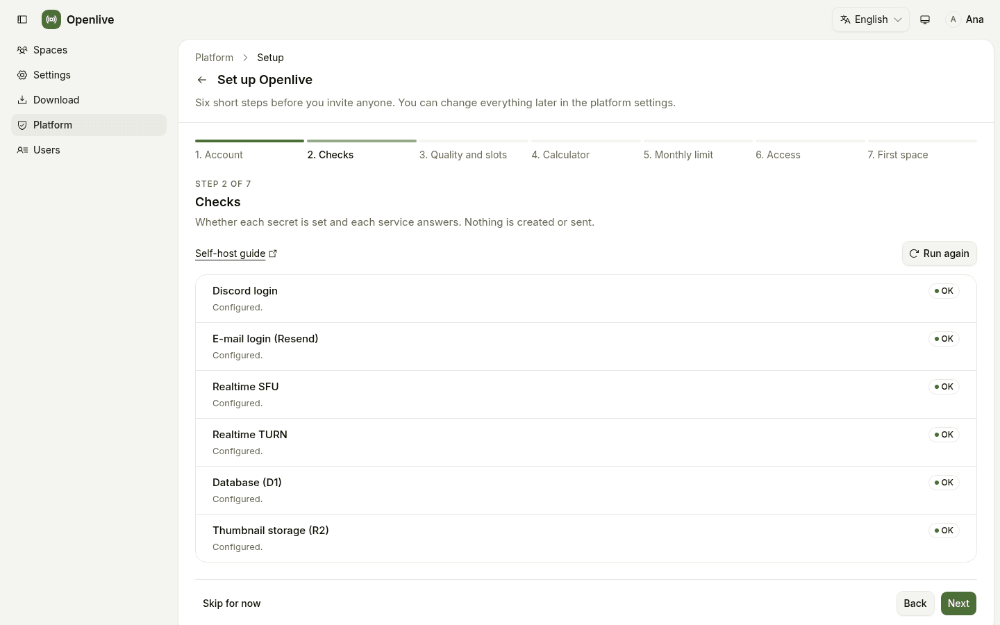
      </picture>
      <p align="center">First-run wizard: every secret and service checked</p>
    </td>
  </tr>
  <tr>
    <td>
      <picture>
        <source media="(prefers-color-scheme: dark)" srcset="docs/img/screens/sign-in-dark.png">
        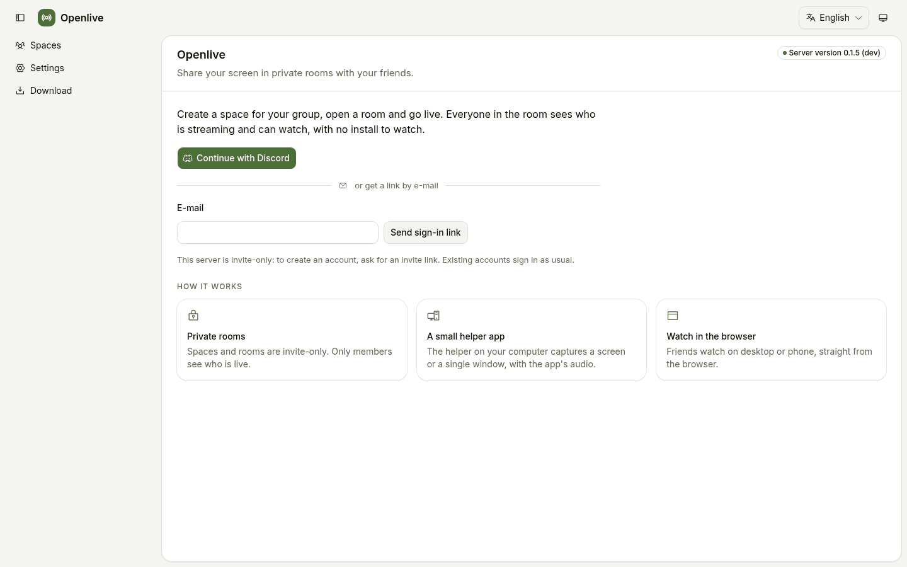
      </picture>
      <p align="center">Sign in with Discord or an e-mail link</p>
    </td>
    <td>
      <picture>
        <source media="(prefers-color-scheme: dark)" srcset="docs/img/screens/tutorial-dark.png">
        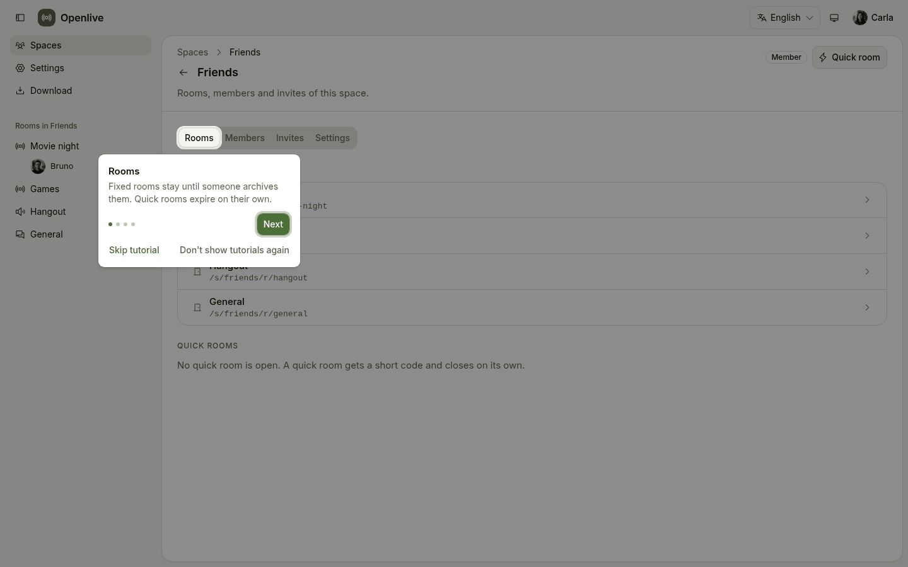
      </picture>
      <p align="center">A short tutorial on each screen's first visit</p>
    </td>
  </tr>
</table>

<table>
  <tr>
    <td width="25%">
      <picture>
        <source media="(prefers-color-scheme: dark)" srcset="docs/img/screens/room-mobile-dark.png">
        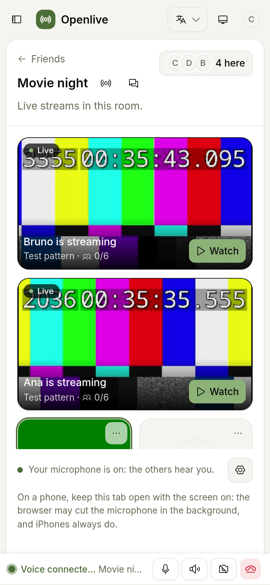
      </picture>
    </td>
    <td width="25%">
      <picture>
        <source media="(prefers-color-scheme: dark)" srcset="docs/img/screens/room-chat-sheet-mobile-dark.png">
        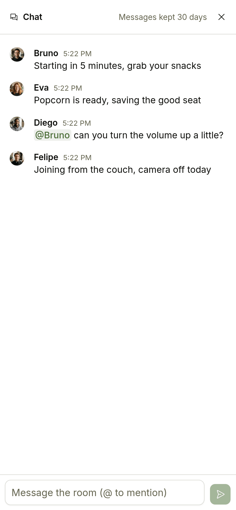
      </picture>
    </td>
    <td width="25%">
      <picture>
        <source media="(prefers-color-scheme: dark)" srcset="docs/img/screens/player-mobile-dark.png">
        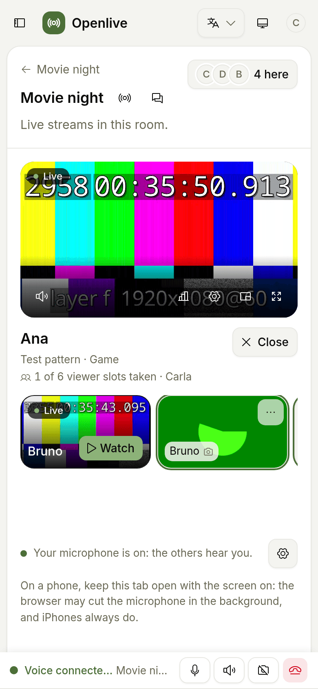
      </picture>
    </td>
    <td width="25%">
      <picture>
        <source media="(prefers-color-scheme: dark)" srcset="docs/img/screens/room-voice-mobile-dark.png">
        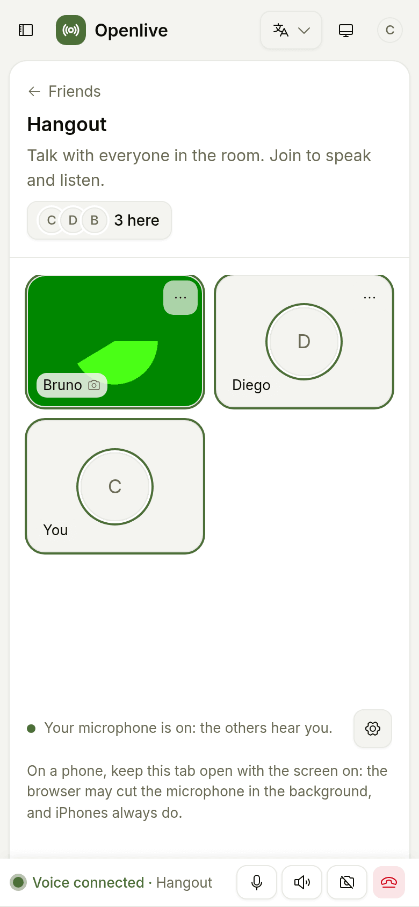
      </picture>
    </td>
  </tr>
</table>

## Features

**Watch**

- In any recent browser, on desktop or phone. No install, no account on a third-party service.
- First frame in about 0.4 s: the player connects while you look at the room and starts pulling
  the stream when you point at its card.
- Automatic quality with a manual override (1080p60, 720p60, 480p30), volume and mute per stream,
  theater mode, picture in picture, full screen, and stats for nerds (`I`).
- A full stream has a queue, members first. A tab left in the background or an idle viewer stops
  receiving video but keeps their seat.

**Stream**

- A native helper captures a screen or a single window with that app's sound: on Linux with Go,
  GStreamer and PipeWire, encoding on the GPU (NVENC, VA-API) or with x264; on macOS with
  ScreenCaptureKit and VideoToolbox.
- Start, pause (privacy curtain), change quality and stop from the web; the helper sits in the
  tray.
- Visual clicks, if the streamer allows them: a viewer clicks the video and a pulsing marker with
  their name shows on the streamer's screen (KDE Plasma for now). Nothing is clicked for real.
- Presets: text and code (1080p30), game (1080p60), max (1440p60) and native (the screen's own
  resolution, up to 4K60), plus Game 120
  (1080p120) and Max 120 (1440p120) when the admin allows 120 fps. Sent as simulcast layers so
  each viewer gets what their connection holds.

**Talk**

- Voice in any room that has it: mute, deafen, push-to-talk, input and output devices, volume per
  person and a speaking ring. Owners and admins can server-mute or remove someone from voice. Up to
  12 people by default.
- Cameras in voice, off by default: two simulcast layers (360p and 180p), 6 per room by default,
  in a call layout that fills the screen (side by side, a grid, you in a corner in a call of two,
  a click to pin someone), with the larger tiles on the better layer. On a bad network the camera steps down before the
  voice does.
- Text chat per room: mentions, edit and delete, unread badges, links, and history kept for none,
  7, 30 or 90 days, as the room chooses.
- Each room picks what it has: streams, voice (with or without cameras), text, or any mix.

**Rooms and access**

- Spaces for each group, fixed rooms, and quick rooms with a short join code that close on
  their own.
- Invite links with roles (owner, admin, member, guest), optional approval and expiry. Guests
  watch only until someone lets them stream. Restricted rooms, bans and an audit log.
- Sign in with Discord or a magic link by e-mail. English and Brazilian Portuguese.

**Costs and brakes**

- A monthly bandwidth limit in plain tiers: Cloudflare's free 1,000 GB, fixed amounts, a custom
  value or unlimited, with the cost of each.
- The usage meter compares Openlive's own estimate with Cloudflare's reported egress, and the
  brakes act on the larger. At the limit new streams are blocked (or only warned, if you choose); near it,
  economy mode caps the quality. Voice keeps working at the limit; new cameras are blocked.
- Ceilings for resolution, frame rate, bitrate, viewers per stream and streams per room, which
  spaces and rooms can only lower.

**Admin**

- A first-run wizard checks every secret and binding, walks through the ceilings and the limit,
  and opens the first space.
- The platform overview shows the month's usage, projection and cost per space, plus how streams
  played (first frame, freezes, dropped streams) and which helpers had trouble.
- Every account with its spaces, sessions and devices: revoke, ban, delete. Spaces can be
  suspended.

## How it works

![The big picture: the helper on the streamer's PC publishes to the Realtime SFU; the Worker, with its Durable Objects, D1, R2 and Analytics Engine, runs the rooms; viewers pull one layer in the browser]

One Cloudflare Worker serves the web app, the REST API and the room WebSockets. Each room is a
Durable Object that knows who is here, who is live and who holds a viewer slot; D1 keeps the
accounts, spaces and usage; R2 keeps the stream thumbnails. Media never touches the Worker: the
helper publishes to the Realtime SFU and viewers subscribe to it.

The wire protocol is in [docs/PROTOCOL.md](docs/PROTOCOL.md). Why it is all on Cloudflare, what that costs and what keeps it
portable: [docs/why-cloudflare.md](docs/why-cloudflare.md).

## Numbers

| What                   | Measured                                                                      |
| ---------------------- | ----------------------------------------------------------------------------- |
| Glass-to-glass latency | about 100 ms (median 102 ms at 1080p60, 91 ms at 1440p60)                     |
| First frame            | about 0.4 s (median 363 ms, pulling on hover)                                 |
| Quality                | 1080p60 and 1440p60; native up to 4K60; 1080p120 and 1440p120, off by default |
| Free bandwidth         | 1,000 GB a month per instance (Cloudflare Realtime), about 19 full hours      |

## Self-host

Each group deploys to its own Cloudflare account, on its own domain or a free `workers.dev`
address, without editing any file:

```sh
pnpm install
pnpm run setup -- --domain live.example.com --dry-run   # checks and plan; calls nothing
pnpm run setup -- --domain live.example.com             # or: --workers-dev <name>
```

The setup checks the toolchain and the account, helps with the Discord and Resend keys, creates
what is missing, deploys, and prints the install code that makes you the admin. It is safe to run
again. [docs/self-host.md](docs/self-host.md) is the full checklist, with costs and
troubleshooting.

## The helper

Viewers need only the browser; whoever streams installs the helper. Releases ship a tarball
(`./install.sh` into `~/.local`) and a Flatpak for Linux, and a disk image for macOS; see
[packaging/linux/README.md](packaging/linux/README.md) and
[packaging/macos/README.md](packaging/macos/README.md). The official builds are on
[GitHub Releases](https://github.com/henriquefps/openlive/releases); a self-hosted instance serves
them to its members from `/download` after
`pnpm run helper:publish -- --env production --from-release latest` (nothing to build;
[docs/self-host.md](docs/self-host.md#6-install-the-helper-and-stream)). Then pair it with your
instance and start it from the menu:

```sh
openlive-helper pair --instance https://live.example.com
openlive-helper doctor   # desktop, GPU, encoders and an encode test, for bug reports
```

| System  | Helper                                                                                  |
| ------- | --------------------------------------------------------------------------------------- |
| Linux   | ✅ Wayland (KDE tested; GNOME, Hyprland, Sway expected) through the portal and PipeWire |
| macOS   | ✅ macOS 13 or later, ScreenCaptureKit and VideoToolbox; a signed, notarized disk image |
| Windows | Last                                                                                    |

Watching works on every system with a recent browser.

## Android app (beta)

An Android app (7 or later) lets you watch, chat and talk from the phone, with voice that keeps
running in the background. It is a beta and is not on the Play Store: download the `.apk` from the
[releases tagged `android-v`](https://github.com/henriquefps/openlive/releases?q=android-v&expanded=true),
open it on the phone, allow installing from that source and choose "Install anyway" if Play Protect
warns, then add your server with an invite link. The release lists the SHA-256 of the file and of
the signing certificate. [Obtainium](https://obtainium.imranr.dev/) keeps it up to date: add
`https://github.com/henriquefps/openlive`, turn on "Include prereleases", and filter APKs by
`android` and release titles by `^Openlive Android`. The same app works with every Openlive
server. Details: [apps/mobile/README.md](apps/mobile/README.md).

## Project layout

```
apps/
  api/          Worker (Hono): REST API, RoomDO, UserHubDO, SpaceDO, D1 migrations, wrangler.jsonc
  web/          React + Vite web app (shadcn/ui), English and Brazilian Portuguese
packages/
  protocol/     JSON Schema of the room protocol, generated TS and Go types
  usage/        The bandwidth and cost model shared by the API and the web
helper/         The native helper (Go): capture, encode, publish, tray
packaging/      Helper packages (Linux tarball and Flatpak)
scripts/        Self-host setup, README screenshots, icon tools
docs/           Protocol, self-hosting, observability, why Cloudflare
```

## Development

Node 26 (`.nvmrc`), pnpm 12.15 (`corepack enable`), Go 1.27 and GStreamer for the helper.

```sh
pnpm install
pnpm lint          # ESLint over the whole workspace
pnpm typecheck     # tsc in every package
pnpm test          # Vitest in every package (the Worker tests run in workerd)
pnpm format:check  # Prettier
pnpm i18n:check    # every string in both languages
(cd helper && go test ./... && golangci-lint run)
```

Run it locally: `pnpm --filter @openlive/api dev` (the Worker on :8790) and
`pnpm --filter @openlive/web dev` (Vite on :5179). [apps/web/README.md](apps/web/README.md) covers
the design system and localization, and [helper/README.md](helper/README.md) the local
end-to-end loop with a real stream.

All code, comments, commit messages and docs are in English. The API returns error codes with
parameters (`{ "code": "stream_permission_required" }`), never user-facing text; the web app
translates them.

## Contributing

Bug reports, ideas and pull requests are welcome: [CONTRIBUTING.md](CONTRIBUTING.md) covers running
it locally, the conventions and the pull request flow. Commits are signed off under the
[Developer Certificate of Origin](CONTRIBUTING.md#developer-certificate-of-origin) (`git commit -s`).
Please follow the [Code of Conduct](CODE_OF_CONDUCT.md), and report vulnerabilities privately as
[SECURITY.md](SECURITY.md) explains.

## License

Openlive is licensed under the [GNU Affero General Public License v3.0](LICENSE) (AGPL-3.0-only). You can use, modify and self-host it freely; if you
offer a modified version to others over a network, you must make its source code available to
them under the same license. The bundled third-party packages and their licenses are listed in
[THIRD_PARTY_NOTICES](THIRD_PARTY_NOTICES), and the helper's in the `THIRD_PARTY_NOTICES` shipped
with each release.
